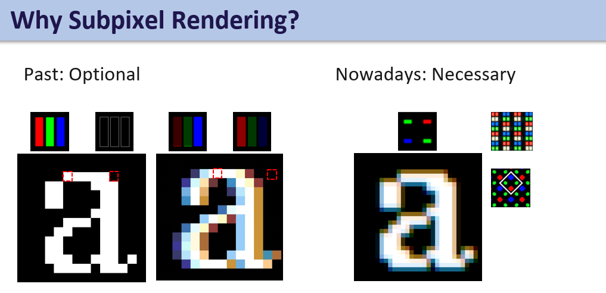
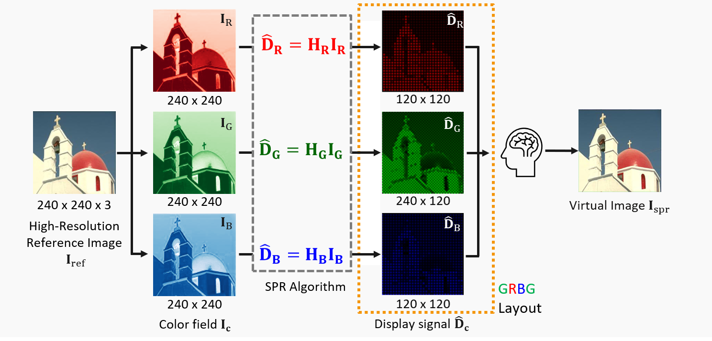

# Subpixel Rendering：從 Lu Fang 論文復刻到 GRBG MMSE SPR

> 子像素渲染專案學習，不需要從零開始，
> 目標是能讀懂SPR流程在做什麼、為什麼這樣寫，並能跑出和本專案一致的結果。
>
> **起點**：復刻 Lu Fang 等人的 2-D MMSE 子像素下採樣（對角線排列面板）。
> **終點**：同一套方法搬到實際的 **GRBG 面板**，並和傳統下採樣法 DDSD 比較（主程式 `main.py`）。
>
> 論文：L. Fang, O. C. Au, K. Tang, X. Wen, H. Wang, "[Novel 2-D MMSE Subpixel-Based Image Down-Sampling](https://ieeexplore.ieee.org/document/6101564),"
> *IEEE TCSVT*, vol. 22, no. 5, 2012.

## 1. SPR 是什麼

SPR（Subpixel Rendering，子像素渲染）是一種透過獨立控制顯示器像素內部的紅、綠、藍（RGB）子像素亮度的技術。
為什麼需要：因為現今顯示器有許多不同的 Layout，不能像以前 RGB stripe 直接 1-1 mapping 過去，所以需要 SPR 決定顯示器要送什麼信號。





接下來要從 Lu Fang 團隊的 SPR 論文先去一對一對照他們SPR是怎麼做的，再來到我們實驗室目前有的 GRBG 面板去實踐出 SPR

## 2. 快速開始

```bash
conda create -n spr python=3.10 -y # 我是用conda你可以用venv的方式，總之就是建立一個虛擬環境
conda activate spr
pip install -r requirements.txt
python main.py test_images/test_1.png
```

沒有 conda 的話，用 Python 內建的 venv（Windows）：

```bash
python -m venv .venv
.venv\Scripts\activate
pip install -r requirements.txt
```

> ⚠️ Python 版本**不要低於 3.9** 就好。
> 所有指令在專案根目錄執行。輸入方式：`python xxx.py 圖片路徑`、`python xxx.py --white`（全白圖），或不加參數跳出選圖視窗。
> 輸入尺寸設定為 **240×240**，是為了符合目前面板的解析度（`test_images/` 的四張測試圖都是 240×240；若給其他尺寸，程式會直接縮放成 240×240）。

## 3. 每個程式在做什麼

建議依表格順序閱讀，每支程式都沿用前一支的函式。

> **學習順序**：先讀 **Part A：Lu Fang 復刻**（順序 1–2、第 4.2 節），確定知道 MMSE 怎麼做之後，再讀 **Part B：GRBG 實作**（順序 3–5、第 4.3 節）。

| 順序 | 程式 | 做什麼 |
|---|---|---|
| 1 | `diagonal_mmse_build.py` | 只看 Diagonal 面板的 R 通道，用兩種方法建出論文 eq.(9) 的 $H_r$、$H_R$ 並比對：**方法 A** 照論文 Appendix A 用 $k_0 \dots k_4$ 手填 block；**方法 B** 直接建重建矩陣 $A$，算 $A^\top A$、$A^\top$。兩者相同，代表方法 B 可信 |
| 2 | `diagonal_mmse_spr.py` | Diagonal 面板完整流程（**論文復刻**）：DDSD 與 MMSE 各算一次 $r, g, b$ → 擺上面板 → 人眼插值成虛擬影像 $L'$，印出誤差比較表 |
| 3 | `grbg_mmse_build.py` | 換成 GRBG 面板：定義 $H_{RB}$、$H_G$ 與 layout，驗證方法 A = 方法 B，並證明兩組綠色 $g_1$、$g_2$ 互相耦合、必須一起解 |
| 4 | `grbg_mmse_spr.py` | GRBG 面板完整流程：DDSD 與 MMSE（$g_1$、$g_2$ 聯合求解）→ 面板 → 虛擬影像 |
| 5 | `main.py` | ★ 主程式：同一張圖跑 GRBG 的 MMSE 與 DDSD，印比較表並存圖（只呼叫 `grbg_mmse_spr.py` 的函式） |

**主要函式**

| 函式 | 所在 | 作用 |
|---|---|---|
| `interp_mask` | `diagonal_mmse_build.py` | 論文的 $H_{BI}$（5×5 bilinear） |
| `k_coeffs`、`build_Hr_block`、`build_HR_block` | `diagonal_mmse_build.py` | 方法 A：照論文填出 $H_r$、$H_R$ |
| `build_A_dense` / `build_A_sparse` / `build_A_grbg` | build / spr / grbg build | 方法 B：建重建矩陣 $A$（稠密版只用於小尺寸驗證；稀疏版實際求解；GRBG 版自動帶入 GRBG 參數） |
| `solve_channel` | `diagonal_mmse_spr.py` | 解 eq.(9) 並 clip 到 $[0,1]$，回傳 $(\mathbf r,\ \text{clip 前的殘差})$ |
| `mmse_solve` | spr 兩支 | 每個顏色通道解一次 eq.(9)（GRBG 的 $g_1$、$g_2$ 合在一起解） |
| `ddsd_downsampling` | `diagonal_mmse_spr.py` | DDSD：每顆子像素直接取 $L$ 在自己位置的值（兩種面板共用） |
| `place_panel` | `diagonal_mmse_spr.py` | $r \otimes I_r$：把子像素值擺到面板（兩種面板共用） |
| `reconstruct` | spr 兩支 | $H_{interp} \ast (\cdot)$：人眼插值 |
| `build_A_G` | `grbg_mmse_build.py` | $A_G = [A_{g_1} \mid A_{g_2}]$ |

## 4. MMSE 數學（Lu Fang 的寫法）

### 4.1 符號對照

> **備註**：本節的公式照論文原文的符號寫，方便對照論文閱讀；但本實驗室（程式、流程圖、之後的報告）用的是右欄的符號。
> **讀懂論文後，請改用右欄「我們的符號」來思考與撰寫。**

| 論文（Lu Fang） | 我們的符號（流程圖 / 範例圖） | 程式變數 | 意義 |
|---|---|---|---|
| $L$（分量 $R, G, B$） | $I_{ref}$（分量 $I_c$） | `input_img` | 高解析輸入，$3M \times 3N$（本專案 240×240） |
| $S$（分量 $r, g, b$） | $D_c$（MMSE 解為 $\hat D_c$） | `driving_signals`（`d_R`、`d_G`、`d_B`） | 每顆子像素的驅動訊號，$M \times N$。**不是影像** |
| $I_r, I_g, I_b$ | $K_c$ | `LAYOUT` | 子像素位置矩陣（只有一個 1） |
| $r \otimes I_r$ | $D_c \otimes K_c$ | `place_panel` → `D` | 把子像素擺到面板上 |
| $H_{interp}$（本專案用 $H_{BI}$） | $M_c$ | `mask` | 人眼插值濾波器 |
| $L'$（分量 $R', G', B'$） | $V_c$（整張為 $I_{spr}$） | `V` | 虛擬影像，$3M \times 3N$ |
| $H_r$ | $H_{D_c}$ | $A^\top A$ | eq.(9) 左邊的矩陣 |
| $H_R$ | $H_{I_c}$ | $A^\top$ | eq.(9) 右邊的矩陣 |
| $H = H_r^{-1}H_R$ | $H_c = H_{D_c}^{-1}H_{I_c}$ | — | 流程圖的 $\hat D_c = H_c I_c$ 就是 eq.(10) |

> 注意：我們的 $H_R$ 是**紅色通道的 SPR 運算子**（$\hat D_R = H_R I_R$），和論文 eq.(9) 的 $H_R$（右邊的矩陣）同名但意義不同。

用我們的符號寫一次紅色通道的 MMSE（以 GRBG 面板為例）：


### 4.2 Diagonal 面板（論文）

**虛擬影像模型與 MMSE 問題（eq.4）**：找 $S$ 讓虛擬影像 $L'$ 最接近原圖 $L$

$$
\min_{r,g,b}\ \|R-R'\|_2^2+\|G-G'\|_2^2+\|B-B'\|_2^2
\quad \text{s.t.}\quad
R' = H_{interp} \ast (r \otimes I_r),\ \ 
G' = H_{interp} \ast (g \otimes I_g),\ \ 
B' = H_{interp} \ast (b \otimes I_b)
$$

**子像素位置（eq.5）**，$\otimes$ 為 Kronecker 積，把 $M\times N$ 的 $r, g, b$ 展開成 $3M \times 3N$：

$$
I_r=\begin{bmatrix}1&0&0\\0&0&0\\0&0&0\end{bmatrix},\quad
I_g=\begin{bmatrix}0&0&0\\0&1&0\\0&0&0\end{bmatrix},\quad
I_b=\begin{bmatrix}0&0&0\\0&0&0\\0&0&1\end{bmatrix}
$$

**插值濾波器** $H_{BI}$（bilinear，$\alpha_{1,2}=\tfrac23,\ \beta_{1,2}=\tfrac13,\ \alpha_{3,4}=\tfrac49,\ \beta_{3,4}=\tfrac19,\ \gamma_{1\sim4}=\tfrac29$）：

$$
H_{BI}=\begin{bmatrix}
\beta_3&\gamma_2&\beta_2&\gamma_4&\beta_4\\
\gamma_3&\alpha_3&\alpha_2&\alpha_4&\gamma_1\\
\beta_1&\alpha_1&1&\alpha_1&\beta_1\\
\gamma_1&\alpha_4&\alpha_2&\alpha_3&\gamma_3\\
\beta_4&\gamma_4&\beta_2&\gamma_2&\beta_3
\end{bmatrix}
=\frac19\begin{bmatrix}
1&2&3&2&1\\2&4&6&4&2\\3&6&9&6&3\\2&4&6&4&2\\1&2&3&2&1
\end{bmatrix}
$$

**三個通道可分開解（eq.6）**，以紅色為例：

$$
\min_{r}\ E=\|R-R'\|_2^2 \quad \text{s.t.}\quad R' = H_{BI} \ast (r \otimes I_r)
$$

**對 $r_{i,j}$ 微分並設為 0（eq.8）**，每個 $r_{i,j}$ 得到一條方程（左邊是 3×3 鄰域、右邊是 $H_{BI}$ 加權的 5×5 鄰域）。
其中 $H_{BI}(m,n)$ 以中心為 $(0,0)$、$m,n \in [-2,2]$ 編號，$H_{BI}(0,0)$ 就是上面矩陣正中央的 1，$H_{BI}(-2,-2)=\beta_3$ 是左上角：

$$
\begin{aligned}
&k_3 r_{i-1,j-1}+k_2 r_{i-1,j}+k_4 r_{i-1,j+1}
+k_1 r_{i,j-1}+k_0 r_{i,j}+k_1 r_{i,j+1}
+k_4 r_{i+1,j-1}+k_2 r_{i+1,j}+k_3 r_{i+1,j+1} \\
&\qquad = \sum_{m=-2}^{2}\sum_{n=-2}^{2} H_{BI}(m,n)\, R_{3i-2+m,\;3j-2+n}
\end{aligned}
$$

$$
\begin{aligned}
k_0 &= 1+2\textstyle\sum_{k=1}^{4}(\alpha_k^2+\beta_k^2+\gamma_k^2) = \tfrac{361}{81}, &
k_1 &= 2(\alpha_1\beta_1+\alpha_3\gamma_1+\beta_3\gamma_4+\alpha_4\gamma_3+\beta_4\gamma_2) = \tfrac{76}{81},\\
k_2 &= 2(\alpha_2\beta_2+\alpha_3\gamma_4+\beta_3\gamma_1+\alpha_4\gamma_2+\beta_4\gamma_3) = \tfrac{76}{81}, &
k_3 &= 2(\alpha_3\beta_3+\gamma_2\gamma_3) = \tfrac{16}{81},\quad
k_4 = 2(\alpha_4\beta_4+\gamma_1\gamma_4) = \tfrac{16}{81}
\end{aligned}
$$

**矩陣形式（eq.9）與解（eq.10）**：把全部 $MN$ 條方程寫在一起，$\mathbf r$、$\mathbf R$ 是 row-ordered 向量

$$
H_r\,\mathbf r = H_R\,\mathbf R,\qquad H_r \in \mathbb R^{MN\times MN},\ H_R \in \mathbb R^{MN\times 9MN}
$$

$$
\mathbf r = H_r^{-1}H_R\,\mathbf R = H\,\mathbf R
$$

**程式的做法（方法 B）**：$R' = H_{BI} \ast (r \otimes I_r)$ 是線性的（先擺放、再卷積），所以可以寫成一個矩陣 $A$：

$$
\mathrm{vec}(R') = A\,\mathbf r,\qquad
A = \mathcal C(H_{BI})\,P_r \in \mathbb R^{9MN\times MN}
$$

- $P_r \in \{0,1\}^{9MN\times MN}$：擺放矩陣，$P_r\,\mathbf r = \mathrm{vec}(r \otimes I_r)$，每個 column 只有一個 1，把 $r_{i,j}$ 放到 $(3i-2,\,3j-2)$。
- $\mathcal C(H_{BI}) \in \mathbb R^{9MN\times 9MN}$：和 $H_{BI}$ 做二維週期卷積的矩陣（block-circulant）。

逐元素寫出來（列 $(k,l)$ 是 $L'$ 的像素、行 $(i,j)$ 是子像素；位移以週期 $3M$、$3N$ 計算，超出 $[-2,2]$ 為 0）：

$$
A_{(k,l),\,(i,j)} = H_{BI}\big(k-(3i-2),\ l-(3j-2)\big)
$$

也就是 $A$ 的每一個 column = 單一子像素 $r_{i,j}$ 經過 $H_{BI}$ 灑在 $L'$ 上的樣子，攤平成一個向量（程式 `build_A_sparse` 就是照這條式子填值）。代入 eq.(6) 微分即得

$$
A^\top A\,\mathbf r = A^\top \mathbf R \quad\Longrightarrow\quad H_r = A^\top A,\quad H_R = A^\top
$$

所以不必手推 $k_0 \dots k_4$，直接算 $A^\top A$ 就和論文完全相同（`diagonal_mmse_build.py` 驗證），換 Layout 也不用重推公式。

**限制在面板可顯示範圍（本專案加的步驟）**：eq.(10) 的解可能小於 0 或大於 1（例如 `test_4` 有約 1/3 的值超出），
但面板只能顯示 $[0,1]$，所以程式最後做

$$
\mathbf r \leftarrow \mathrm{clip}\big(H_r^{-1}H_R\,\mathbf R,\ 0,\ 1\big)
$$

面板與虛擬影像都用 clip 後的值計算；程式印出的正規方程殘差則用 clip **前**的解，用來確認 eq.(9) 有解對。

**比較基準 DDSD（eq.1）**：不解任何方程，每顆子像素直接取 $L$ 在自己位置的值

$$
r_{i,j} = R_{3i-2,\,3j-2},\qquad g_{i,j} = G_{3i-1,\,3j-1},\qquad b_{i,j} = B_{3i,\,3j}
$$

> 程式用 0 起算的索引：論文 1 起算的 $(3i-2,\,3j-2)$ 在程式中是 $(3i,\,3j)$。

### 4.3 GRBG 面板（本專案延伸）

同一套寫法，只換子像素位置與插值濾波器。$L$ 為 $2M \times 2N$，$S$ 有四個 $M \times N$ 分量 $r, b, g_1, g_2$：

$$
\text{GRBG}=\begin{bmatrix}G&R\\B&G\end{bmatrix},\quad
I_{g_1}=\begin{bmatrix}1&0\\0&0\end{bmatrix},\
I_r=\begin{bmatrix}0&1\\0&0\end{bmatrix},\
I_b=\begin{bmatrix}0&0\\1&0\end{bmatrix},\
I_{g_2}=\begin{bmatrix}0&0\\0&1\end{bmatrix}
$$

$$
R' = H_{RB} \ast (r \otimes I_r),\quad
B' = H_{RB} \ast (b \otimes I_b),\quad
G' = H_G \ast (g_1 \otimes I_{g_1} + g_2 \otimes I_{g_2})
$$

$$
H_{RB}=\frac14\begin{bmatrix}1&2&1\\2&4&2\\1&2&1\end{bmatrix},\qquad
H_G=\frac14\begin{bmatrix}0&1&0\\1&4&1\\0&1&0\end{bmatrix}
$$


### 4.4 怎麼確認算對

| 檢查 | 程式印出 | 正確時 |
|---|---|---|
| 方法 A = 方法 B | `‖Hr_block − AᵀA‖` | < 1e-12 |
| eq.(9) 有解對 | `normal-eq residual max\|Aᵀ(input − A d)\| (before clip)` | ≈ 1e-15 |
| $A$ 與面板一致 | `explicit mask*D vs implicit A d` | ≈ 1e-16 |
| DC 增益 | `--white` 時的 rms | 0 |
| MMSE 較好 | rms 比較表 | MMSE ≤ DDSD（clip 後理論上不再保證，但四張測試圖都成立） |

## 5. 輸出與預期輸出

- 自己跑程式的輸出寫到 `result/`（已列入 `.gitignore`，不會進 git）。
- `expected_output/` 是用 `test_images/` 四張圖跑出的**預期輸出**，請拿自己的 `result/` 和它比對。
- 兩者結構相同：`{圖片名}/{面板}/{方法}/{圖片名}_{面板}_{方法}_{panel 或 virtual}.png`，
  例如 `expected_output/test_2/GRBG/MMSE/test_2_GRBG_MMSE_virtual.png`。
  `panel` 是面板（$r \otimes I_r$ 等擺好的子像素），`virtual` 是虛擬影像 $L'$。
- **怎麼比對**：同一張輸入圖、同一個路徑的兩張圖應該**完全相同**。把 `result/` 和 `expected_output/` 裡對應的圖並排打開看即可；
  數字則和下表、下方完整輸出對照。

| 圖片 | 內容 | Diagonal rms（DDSD → MMSE） | GRBG rms（DDSD → MMSE） |
|---|---|---|---|
| `test_1.png` | 合成測試圖（條紋、色塊、zone plate、斜線） | 0.4093 → 0.3427 | 0.2447 → 0.2355 |
| `test_2.png` | 建築照片 | 0.1053 → 0.0860 | 0.0736 → 0.0644 |
| `test_3.png` | 放射狀細線 | 0.2121 → 0.1847 | 0.1323 → 0.1233 |
| `test_4.png` | 解析度測試卡 | 0.1372 → 0.1172 | 0.0869 → 0.0790 |

兩支 build 程式不吃圖片，預期輸出：`diagonal_mmse_build.py` 印出 `k0 = 4.456790`、`||Hr_block - A^T A||_inf = 1.8e-15`；
`grbg_mmse_build.py` 所有差距為 `0.0e+00`、`cross block max entry = 0.125`。

`python main.py test_images/test_1.png` 完整輸出：

```
[input] test_1.png -> 240x240
[MMSE] normal-eq residual max|A^T(input - A d)| (before clip) = 4.6e-15
[MMSE] explicit mask*D vs implicit A d : max diff = 2.2e-16

method  max|V-input|  rms
MMSE    0.831         0.2355
DDSD    1.000         0.2447

saved -> result/test_1/GRBG/MMSE/test_1_GRBG_MMSE_panel.png
saved -> result/test_1/GRBG/MMSE/test_1_GRBG_MMSE_virtual.png
saved -> result/test_1/GRBG/DDSD/test_1_GRBG_DDSD_panel.png
saved -> result/test_1/GRBG/DDSD/test_1_GRBG_DDSD_virtual.png
```

機器精度的數字（1e-15 量級）在不同電腦上可能略有差異，其他數字應完全一致。

## 6. 延伸 (有空可以想一下)

1. **FFT 快速解**：利用 block-circulant 結構在頻域逐頻率求解（程式裡的週期邊界 `%` 就是為此保留）。
2. **其他Layout（RGGB、BGGR、GBRG）或 Diamond PenTile**：其他 Bayer 相位只要改 `grbg_mmse_build.py` 的 `LAYOUT`（四種子像素的位置）；
   Diamond PenTile 這類子像素種類或插值濾波器不同的排列，還要一起改 `CHANNEL`、`MASK`，以及 `grbg_mmse_spr.py` 裡寫死 R、B、G1、G2 的 `mmse_solve` 和寫死兩種 mask 的 `reconstruct`；`build_A_sparse`、`place_panel` 不用動。
